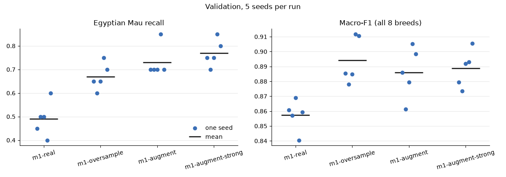
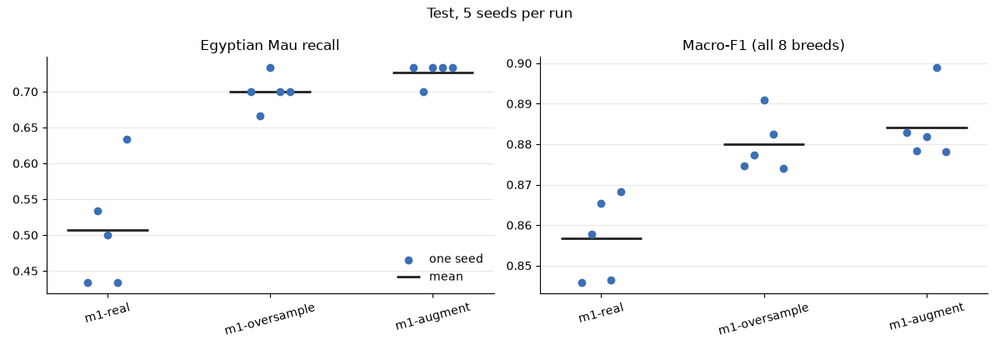

# Experiment Log

Keep one section per meeting. Add the tables and plots you make from
`runs/*/results.json` and `test-results.json` (save the plots in `evidence/`),
link the pools' contact sheets, and explain what you see. A result that shows no
effect is still a result: say so and say why.

## Meeting 1 — Real-data baselines

- **Question:** How much do oversampling and ordinary augmentation help Egyptian
  Mau recall compared with the imbalanced data?
- **Full analysis:** [`meetings/meeting1.ipynb`](meetings/meeting1.ipynb) (all
  tables, plots and checks below are made there).
- **How `oversample()` works:** 55 = 3 × 15 + 10, so every one of the 15 Egyptian
  Mau training photos is repeated 3 times and 10 photos chosen at random with the
  seeded `rng` get a 4th copy; the list is then shuffled. This is the most even
  split possible (no photo is used more than once more than another).
  **Check:** for seeds 0–4 the result always has 55 names, all from the 15
  training photos, all 15 used (5 × 3 times, 10 × 4 times), and the same seed
  gives the same list; the `added` lists in `runs/m1-oversample/seed-*/run.json`
  show the same counts.
- **How `augment()` works, and why these transforms:** a random rotation (± 15°),
  a random crop of 50–100 % of the area resized back to the original size, a
  horizontal flip and a colour jitter (brightness, contrast, saturation 0.3, hue
  0.05). Every training image also gets `train.py`'s light transform (crop of
  75–100 %, flip, small jitter) afterwards, so `augment()` adds clearly stronger
  changes on top of it, while keeping the whole cat and its spotted coat
  recognisable. **Check:** the output is a PIL image of the same size, and a grid
  of augmented copies ([`evidence/m1-augment-variants.png`](evidence/m1-augment-variants.png))
  shows that the cat stays recognisable. Examples of both methods:
  [`evidence/m1-examples.png`](evidence/m1-examples.png).
- **Variant tried:** a **strong** `augment()` (rotation ± 30°, crop 25–100 %,
  jitter 0.5 / hue 0.15, greyscale 20 % of the time), selected with
  `SYNTH_AUGMENT=strong` and trained as `m1-augment-strong`. Its copies are more
  varied, but some show only a patch of fur without the head, or are grey.
- **Commands:**

  ```bash
  uv run synth-train --name m1-real --method real
  uv run synth-train --name m1-oversample --method oversample
  uv run synth-train --name m1-augment --method augment --tag augment=moderate
  SYNTH_AUGMENT=strong uv run synth-train --name m1-augment-strong --method augment --tag augment=strong
  uv run synth-test --run m1-real
  uv run synth-test --run m1-oversample
  uv run synth-test --run m1-augment
  ```

- **Results on validation** (20 photos per breed; one Egyptian Mau photo = 0.05):

  | Seed | real: Mau recall | oversample | augment | augment-strong | real: macro-F1 | oversample | augment | augment-strong |
  |---|---|---|---|---|---|---|---|---|
  | 0 | 0.45 | 0.65 | 0.70 | 0.75 | 0.861 | 0.885 | 0.886 | 0.879 |
  | 1 | 0.50 | 0.60 | 0.70 | 0.70 | 0.857 | 0.878 | 0.861 | 0.873 |
  | 2 | 0.50 | 0.65 | 0.70 | 0.75 | 0.869 | 0.885 | 0.879 | 0.892 |
  | 3 | 0.40 | 0.75 | 0.85 | 0.85 | 0.840 | 0.912 | 0.905 | 0.893 |
  | 4 | 0.60 | 0.70 | 0.70 | 0.80 | 0.859 | 0.911 | 0.898 | 0.906 |
  | **mean** | **0.49** | **0.67** | **0.73** | **0.77** | **0.857** | **0.894** | **0.886** | **0.889** |
  | std | 0.074 | 0.057 | 0.067 | 0.057 | 0.010 | 0.016 | 0.017 | 0.013 |

  

- **What I see:** with only 15 training photos the classifier recognises about
  half of the Egyptian Mau photos (0.49, seeds 0.40–0.60), while the other breeds
  are at 0.85–1.00; most of its misses are **Bengal** (26 of 51), then Russian
  Blue and Abyssinian. **Oversampling** raises Mau recall to 0.67 and macro-F1
  from 0.857 to 0.894; every oversampling seed is at or above the best imbalanced
  seed, so this is more than seed noise. **Augmentation** reaches 0.73 (macro-F1
  0.886); it is 0.06 above oversampling, about one validation photo, but the seed
  ranges overlap (0.60–0.75 vs 0.70–0.85), so the two are not clearly different.
  The gain partly costs Bengal, mostly with augmentation: Bengal photos predicted
  as Egyptian Mau rise from 1 of 100 (real) to 6 (oversampling) and 12
  (augmentation), and Bengal recall drops from 0.85 to 0.83 and 0.75; macro-F1
  still rises. **Effect of the variant:** strong augmentation is 0.04 above
  moderate (0.77 vs 0.73), less than one photo, with the same seed range and the
  same macro-F1 (0.889 vs 0.886), and Bengal recall slightly lower (0.73) — no
  evidence that stronger is better, probably because the copies that lose the
  cat's head or colours carry less information about the breed.
- **Choice (made on validation, before testing):** the **moderate** `augment()` is
  kept, so `m1-augment` is the augmentation baseline. The strong variant
  (`m1-augment-strong`) was 0.04 higher in mean Egyptian Mau recall, less than one
  validation photo, with the same seed range (0.70–0.85), so there is no evidence
  that it is better; and some of its copies no longer show a recognisable cat. The
  three runs tested are `m1-real`, `m1-oversample` and `m1-augment`.
- **Test results of the three baselines** (30 photos per breed; one Egyptian Mau
  photo = 0.033):

  | Seed | real: Mau recall | oversample | augment | real: macro-F1 | oversample | augment |
  |---|---|---|---|---|---|---|
  | 0 | 0.433 | 0.700 | 0.733 | 0.846 | 0.875 | 0.883 |
  | 1 | 0.533 | 0.667 | 0.700 | 0.858 | 0.877 | 0.878 |
  | 2 | 0.500 | 0.733 | 0.733 | 0.865 | 0.891 | 0.882 |
  | 3 | 0.433 | 0.700 | 0.733 | 0.846 | 0.883 | 0.899 |
  | 4 | 0.633 | 0.700 | 0.733 | 0.868 | 0.874 | 0.878 |
  | **mean** | **0.507** | **0.700** | **0.727** | **0.857** | **0.880** | **0.884** |
  | std | 0.083 | 0.024 | 0.015 | 0.010 | 0.007 | 0.009 |

  

  The test photos confirm the validation picture. Imbalanced data gives 0.507
  (13–19 of 30 photos), again mostly missed as Bengal (44 of 74 misses).
  Oversampling (0.700) and augmentation (0.727) are both clearly better, with
  every seed above every imbalanced seed, and macro-F1 rises from 0.857 to 0.880
  and 0.884. Augmentation is ahead of oversampling by 0.027, less than one test
  photo, with overlapping seed ranges, so on test, too, the two are not clearly
  different; the order of the means is the same as on validation. The Bengal cost
  is also there: Bengal photos predicted as Egyptian Mau go from 0 of 150 to 1
  (oversampling) and 7 (augmentation).

## Meeting 2 — Text-to-image generation

- **Question:**
- **Setting changed in each pool (one at a time):**
- **Commands:**
- **Contact sheets:** (good and bad images, with the failure types you name)
- **Results on validation:** (table and plot)
- **What I see:**
- **Pool I take forward, and why:**
- **Its test result, compared with the baselines:**

## Meeting 3 — Generation from training photos

- **Question:** How close to the real photos should the synthetic images be?
- **img2img strength values and IP-Adapter scale values tried:**
- **Commands:**
- **Contact sheets:**
- **Results on validation:**
- **What I see:**
- **Best run of each mode, and its test result:**

## Meeting 4 — Editing training photos

- **Question:** Does the classifier need new cats or new backgrounds?
- **Background prompts and outpainting scales tried:**
- **Commands:**
- **Contact sheets:**
- **Results on validation:**
- **What I see:**
- **Best run of each mode, and its test result:**

## Final comparison

- **Runs chosen in Meetings 1–4:**
- **Results:** (your table and plot of their `test-results.json`)
- **Did the validation ranking hold on the test photos?**
- **Recommendation:** use, revise, or reject synthetic data for this task.
