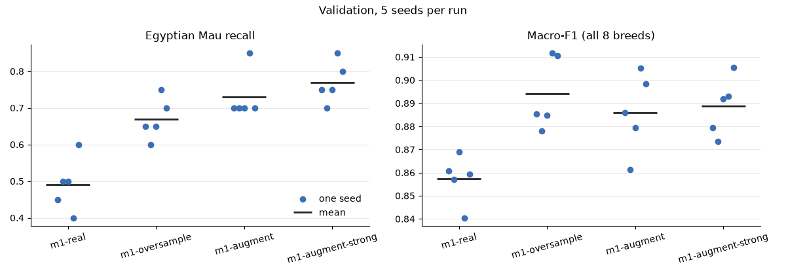
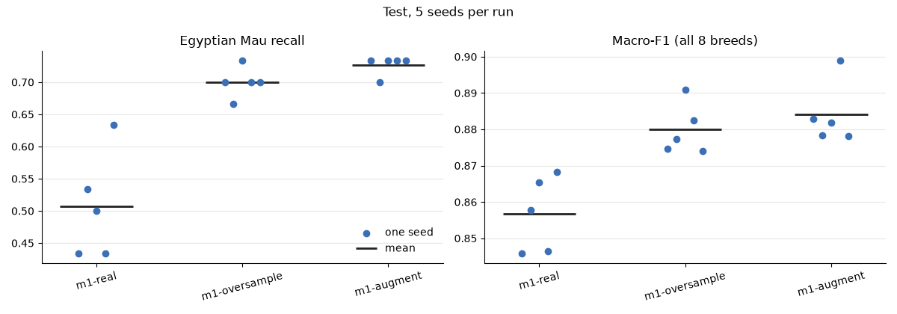
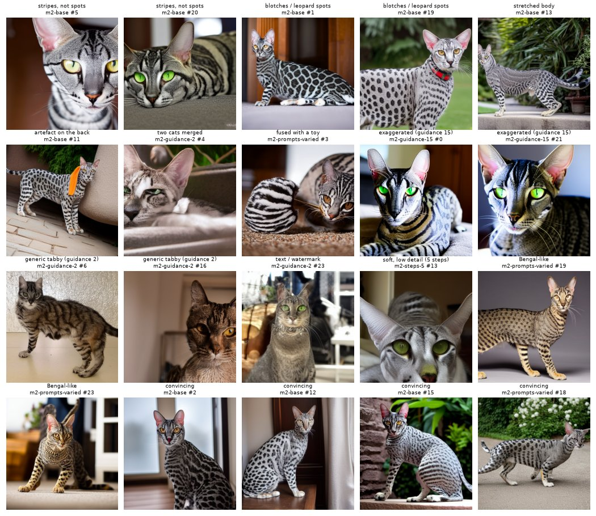
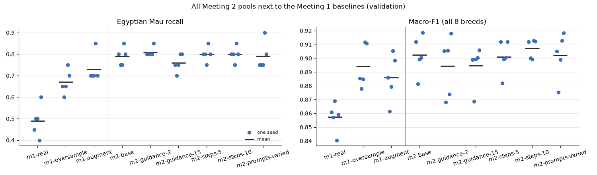
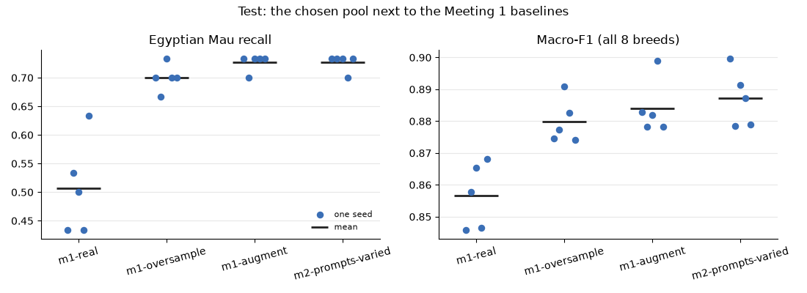

# Experiment Log

Keep one section per meeting. Add the tables and plots you make from
`runs/*/results.json` and `test-results.json` (save the plots in `evidence/`),
link the pools' contact sheets, and explain what you see. A result that shows no
effect is still a result: say so and say why.

## Meeting 1 — Real-data baselines

- **Question:** How much do oversampling and ordinary augmentation help Egyptian
  Mau recall compared with the imbalanced data?
- **Full analysis:** [`meetings/meeting1.ipynb`](meetings/meeting1.ipynb) (all
  tables, plots and checks below are made there).
- **How `oversample()` works:** 55 = 3 × 15 + 10, so every one of the 15 Egyptian
  Mau training photos is repeated 3 times and 10 photos chosen at random with the
  seeded `rng` get a 4th copy; the list is then shuffled. This is the most even
  split possible (no photo is used more than once more than another).
  **Check:** for seeds 0–4 the result always has 55 names, all from the 15
  training photos, all 15 used (5 × 3 times, 10 × 4 times), and the same seed
  gives the same list; the `added` lists in `runs/m1-oversample/seed-*/run.json`
  show the same counts.
- **How `augment()` works, and why these transforms:** a random rotation (± 15°),
  a random crop of 50–100 % of the area resized back to the original size, a
  horizontal flip and a colour jitter (brightness, contrast, saturation 0.3, hue
  0.05). Every training image also gets `train.py`'s light transform (crop of
  75–100 %, flip, small jitter) afterwards, so `augment()` adds clearly stronger
  changes on top of it, while keeping the whole cat and its spotted coat
  recognisable. **Check:** the output is a PIL image of the same size, and a grid
  of augmented copies ([`evidence/m1-augment-variants.png`](evidence/m1-augment-variants.png))
  shows that the cat stays recognisable. Examples of both methods:
  [`evidence/m1-examples.png`](evidence/m1-examples.png).
- **Variant tried:** a **strong** `augment()` (rotation ± 30°, crop 25–100 %,
  jitter 0.5 / hue 0.15, greyscale 20 % of the time), selected with
  `SYNTH_AUGMENT=strong` and trained as `m1-augment-strong`. Its copies are more
  varied, but some show only a patch of fur without the head, or are grey.
- **Commands:**

  ```bash
  uv run synth-train --name m1-real --method real
  uv run synth-train --name m1-oversample --method oversample
  uv run synth-train --name m1-augment --method augment --tag augment=moderate
  SYNTH_AUGMENT=strong uv run synth-train --name m1-augment-strong --method augment --tag augment=strong
  uv run synth-test --run m1-real
  uv run synth-test --run m1-oversample
  uv run synth-test --run m1-augment
  ```

- **Results on validation** (20 photos per breed; one Egyptian Mau photo = 0.05):

  | Seed | real: Mau recall | oversample | augment | augment-strong | real: macro-F1 | oversample | augment | augment-strong |
  |---|---|---|---|---|---|---|---|---|
  | 0 | 0.45 | 0.65 | 0.70 | 0.75 | 0.861 | 0.885 | 0.886 | 0.879 |
  | 1 | 0.50 | 0.60 | 0.70 | 0.70 | 0.857 | 0.878 | 0.861 | 0.873 |
  | 2 | 0.50 | 0.65 | 0.70 | 0.75 | 0.869 | 0.885 | 0.879 | 0.892 |
  | 3 | 0.40 | 0.75 | 0.85 | 0.85 | 0.840 | 0.912 | 0.905 | 0.893 |
  | 4 | 0.60 | 0.70 | 0.70 | 0.80 | 0.859 | 0.911 | 0.898 | 0.906 |
  | **mean** | **0.49** | **0.67** | **0.73** | **0.77** | **0.857** | **0.894** | **0.886** | **0.889** |
  | std | 0.074 | 0.057 | 0.067 | 0.057 | 0.010 | 0.016 | 0.017 | 0.013 |

  

- **What I see:** with only 15 training photos the classifier recognises about
  half of the Egyptian Mau photos (0.49, seeds 0.40–0.60), while the other breeds
  are at 0.85–1.00; most of its misses are **Bengal** (26 of 51), then Russian
  Blue and Abyssinian. **Oversampling** raises Mau recall to 0.67 and macro-F1
  from 0.857 to 0.894; every oversampling seed is at or above the best imbalanced
  seed, so this is more than seed noise. **Augmentation** reaches 0.73 (macro-F1
  0.886); it is 0.06 above oversampling, about one validation photo, but the seed
  ranges overlap (0.60–0.75 vs 0.70–0.85), so the two are not clearly different.
  The gain partly costs Bengal, mostly with augmentation: Bengal photos predicted
  as Egyptian Mau rise from 1 of 100 (real) to 6 (oversampling) and 12
  (augmentation), and Bengal recall drops from 0.85 to 0.83 and 0.75; macro-F1
  still rises. **Effect of the variant:** strong augmentation is 0.04 above
  moderate (0.77 vs 0.73), less than one photo, with the same seed range and the
  same macro-F1 (0.889 vs 0.886), and Bengal recall slightly lower (0.73) — no
  evidence that stronger is better, probably because the copies that lose the
  cat's head or colours carry less information about the breed.
- **Choice (made on validation, before testing):** the **moderate** `augment()` is
  kept, so `m1-augment` is the augmentation baseline. The strong variant
  (`m1-augment-strong`) was 0.04 higher in mean Egyptian Mau recall, less than one
  validation photo, with the same seed range (0.70–0.85), so there is no evidence
  that it is better; and some of its copies no longer show a recognisable cat. The
  three runs tested are `m1-real`, `m1-oversample` and `m1-augment`.
- **Test results of the three baselines** (30 photos per breed; one Egyptian Mau
  photo = 0.033):

  | Seed | real: Mau recall | oversample | augment | real: macro-F1 | oversample | augment |
  |---|---|---|---|---|---|---|
  | 0 | 0.433 | 0.700 | 0.733 | 0.846 | 0.875 | 0.883 |
  | 1 | 0.533 | 0.667 | 0.700 | 0.858 | 0.877 | 0.878 |
  | 2 | 0.500 | 0.733 | 0.733 | 0.865 | 0.891 | 0.882 |
  | 3 | 0.433 | 0.700 | 0.733 | 0.846 | 0.883 | 0.899 |
  | 4 | 0.633 | 0.700 | 0.733 | 0.868 | 0.874 | 0.878 |
  | **mean** | **0.507** | **0.700** | **0.727** | **0.857** | **0.880** | **0.884** |
  | std | 0.083 | 0.024 | 0.015 | 0.010 | 0.007 | 0.009 |

  

  The test photos confirm the validation picture. Imbalanced data gives 0.507
  (13–19 of 30 photos), again mostly missed as Bengal (44 of 74 misses).
  Oversampling (0.700) and augmentation (0.727) are both clearly better, with
  every seed above every imbalanced seed, and macro-F1 rises from 0.857 to 0.880
  and 0.884. Augmentation is ahead of oversampling by 0.027, less than one test
  photo, with overlapping seed ranges, so on test, too, the two are not clearly
  different; the order of the means is the same as on validation. The Bengal cost
  is also there: Bengal photos predicted as Egyptian Mau go from 0 of 150 to 1
  (oversampling) and 7 (augmentation).

## Meeting 2 — Text-to-image generation

- **Full analysis:** [`meetings/meeting2.ipynb`](meetings/meeting2.ipynb).
- **Question:** Which text-to-image generation settings give useful Egyptian Mau
  training images?
- **Setting changed in each pool (one at a time):** the base pool `m2-base` uses
  Stable Diffusion 1.5, one prompt, 30 steps, guidance 7.5, the DPM scheduler and
  seed 1000. Each other pool changes one of these:

  | Pool | Changed | Value (base) |
  |---|---|---|
  | `m2-guidance-2` | guidance | 2 (7.5) |
  | `m2-guidance-15` | guidance | 15 (7.5) |
  | `m2-steps-5` | steps | 5 (30) |
  | `m2-steps-10` | steps | 10 (30) |
  | `m2-prompts-varied` | prompt | 4 varied prompts (1) |

  Base prompt: *a photo of an Egyptian Mau cat, silver coat with random dark
  spots, green eyes, at home*. It names the breed's spotted (not striped) silver
  coat and green eyes, and asks for an ordinary pet photo. The four varied prompts
  keep the breed description but change the scene and pose (lying on a sofa,
  sitting in a garden, walking on the floor, playing with a toy) and use both
  silver and bronze coats.
- **Commands:**

  ```bash
  P="a photo of an Egyptian Mau cat, silver coat with random dark spots, green eyes, at home"
  uv run synth-generate --name m2-base --prompt "$P"
  uv run synth-generate --name m2-guidance-2 --prompt "$P" --guidance 2
  uv run synth-generate --name m2-guidance-15 --prompt "$P" --guidance 15
  uv run synth-generate --name m2-steps-5 --prompt "$P" --steps 5
  uv run synth-generate --name m2-steps-10 --prompt "$P" --steps 10
  uv run synth-generate --name m2-prompts-varied \
    --prompt "a photo of an Egyptian Mau cat lying on a sofa, silver coat with random dark spots, green eyes" \
    --prompt "a photo of an Egyptian Mau cat sitting in a garden, bronze coat with random dark spots, green eyes" \
    --prompt "a full-body photo of an Egyptian Mau cat walking on the floor, silver coat with random dark spots" \
    --prompt "a photo of an Egyptian Mau cat playing with a toy indoors, bronze coat with random dark spots"
  uv run synth-train --name m2-base --method synthetic --pool m2-base --tag changed=base --tag guidance=7.5 --tag steps=30 --tag prompt=single
  uv run synth-train --name m2-guidance-2 --method synthetic --pool m2-guidance-2 --tag changed=guidance --tag guidance=2 --tag steps=30 --tag prompt=single
  uv run synth-train --name m2-guidance-15 --method synthetic --pool m2-guidance-15 --tag changed=guidance --tag guidance=15 --tag steps=30 --tag prompt=single
  uv run synth-train --name m2-steps-5 --method synthetic --pool m2-steps-5 --tag changed=steps --tag guidance=7.5 --tag steps=5 --tag prompt=single
  uv run synth-train --name m2-steps-10 --method synthetic --pool m2-steps-10 --tag changed=steps --tag guidance=7.5 --tag steps=10 --tag prompt=single
  uv run synth-train --name m2-prompts-varied --method synthetic --pool m2-prompts-varied --tag changed=prompt --tag guidance=7.5 --tag steps=30 --tag prompt=varied
  uv run synth-test --run m2-prompts-varied
  ```

- **Contact sheets:** [base](pools/m2-base/contact-sheet.jpg),
  [guidance 2](pools/m2-guidance-2/contact-sheet.jpg),
  [guidance 15](pools/m2-guidance-15/contact-sheet.jpg),
  [steps 5](pools/m2-steps-5/contact-sheet.jpg),
  [steps 10](pools/m2-steps-10/contact-sheet.jpg),
  [varied prompts](pools/m2-prompts-varied/contact-sheet.jpg). Every pool has
  110 attempts. One attempt of `m2-guidance-2` was blocked by the safety checker
  and is kept in the manifest (109 usable). Failure types found (image indices on
  the contact sheets):

  | Failure type | Examples |
  |---|---|
  | Stripes instead of spots (a tabby, not an Egyptian Mau) — about a third of the base sheet | base #5, #7, #8, #14, #20–#22 |
  | Wrong spot pattern: large blotches, dense leopard or dalmatian spots | base #1, #3, #19 |
  | Impossible anatomy or artefacts: stretched body, orange blob, two cats merged, cat fused with a toy | base #11, #13; guidance 2 #4; varied #3, #11 |
  | Exaggerated features: huge pink ears, neon-green eyes, thin Oriental head (strongest with guidance 15) | guidance 15 #0, #6, #21 |
  | Generic tabby, not recognisably an Egyptian Mau (guidance 2) | guidance 2 #6, #12, #16, #18 |
  | Text or watermark | guidance 2 #17, #23 |
  | Soft, low-detail images (5 steps) | steps 5 #7, #13, #20 |
  | Repeated framing: front-facing head close-ups, always silver, always indoors | base #4, #5, #14, #16, #17, #20–#22 |
  | Bengal-like cats: bronze coats with rosette-like spots | varied #19, #23 |

  No painting or cartoon images appeared, because the default negative prompt
  works. Examples of each type next to convincing images:

  

  The same seeds under every setting (one row per pool):
  [`evidence/m2-same-seeds.jpg`](evidence/m2-same-seeds.jpg).
- **Results on validation** (mean of 5 seeds, with the seed range; every seed is
  in [`evidence/m2-validation.csv`](evidence/m2-validation.csv)):

  | Run | Mau recall | Macro-F1 | Bengal recall | Bengal → Mau (of 100) |
  |---|---|---|---|---|
  | m1-real | 0.49 (0.40–0.60) | 0.857 | 0.85 | 1 |
  | m1-oversample | 0.67 (0.60–0.75) | 0.894 | 0.83 | 6 |
  | m1-augment | 0.73 (0.70–0.85) | 0.886 | 0.75 | 12 |
  | m2-base | 0.79 (0.75–0.85) | 0.902 | 0.83 | 4 |
  | m2-guidance-2 | 0.81 (0.80–0.85) | 0.894 | 0.74 | 12 |
  | m2-guidance-15 | 0.76 (0.70–0.80) | 0.895 | 0.83 | 5 |
  | m2-steps-5 | 0.80 (0.75–0.85) | 0.901 | 0.82 | 5 |
  | m2-steps-10 | 0.80 (0.75–0.85) | 0.907 | 0.84 | 5 |
  | m2-prompts-varied | 0.79 (0.75–0.90) | 0.902 | 0.84 | 4 |

  

  One plot per comparison: [guidance](evidence/m2-guidance.png),
  [steps](evidence/m2-steps.png), [prompt](evidence/m2-prompt.png).
- **What I see:** every synthetic pool beats both Meeting 1 baselines on average
  (0.76–0.81 against 0.67 and 0.73). Against oversampling this is clear: 29 of the
  30 pool seeds are at or above its best seed. Against augmentation the gap is
  about one photo and the seed ranges overlap, so it is not clearly different.
  Unlike augmentation, the synthetic images mostly do not cost Bengal (Bengal
  recall 0.82–0.84, 4–5 Bengals called Egyptian Mau), and macro-F1 is as high as
  or higher than with either fix. The generation settings change the images much
  more than the classifier: all pools are within one photo of each other. Guidance
  2 has the highest mean but is the exception on Bengal (0.74, 12 Bengals called
  Egyptian Mau). Its generic-tabby images seem to make the classifier call more
  spotted or striped cats Egyptian Mau. Guidance 15, with exaggerated images, has
  the lowest mean (0.76). 5, 10 and 30 steps give the same recall, and 5 steps
  generates in a quarter of the time. Four varied prompts give the same recall as
  one prompt, with more varied images.
- **Pool I take forward, and why (decided on validation, before testing):**
  **`m2-prompts-varied`**. On validation all six pools are within 0.05 (one photo)
  of each other in Egyptian Mau recall, so no pool wins on the main metric alone.
  `m2-prompts-varied` ties the best pools (0.79 mean recall, 0.902 macro-F1) and
  has the smallest cost to Bengal (Bengal recall 0.84, 4 of 100 Bengal photos
  called Egyptian Mau). Its contact sheet is the only one that removes the
  "repeated framing" failure (varied poses, scenes and coat colours). Guidance 2
  has the highest mean (0.81), but only by a third of a photo, and it gets there
  by calling more Bengals Egyptian Mau (Bengal recall 0.74) with images that are
  often generic tabbies, so it is not chosen.
- **Its test result, compared with the baselines** (30 photos per breed; one
  Egyptian Mau photo = 0.033; every seed in [`evidence/m2-test.csv`](evidence/m2-test.csv)):

  | Run | Mau recall (seeds) | Mean | Macro-F1 | Bengal recall | Bengal → Mau (of 150) |
  |---|---|---|---|---|---|
  | m1-real | 0.433 0.533 0.500 0.433 0.633 | 0.507 | 0.857 | 0.93 | 0 |
  | m1-oversample | 0.700 0.667 0.733 0.700 0.700 | 0.700 | 0.880 | 0.90 | 1 |
  | m1-augment | 0.733 0.700 0.733 0.733 0.733 | 0.727 | 0.884 | 0.86 | 7 |
  | **m2-prompts-varied** | 0.733 0.733 0.733 0.700 0.733 | **0.727** | **0.887** | **0.92** | **0** |

  

  On the test photos `m2-prompts-varied` recognises Egyptian Mau exactly as well
  as augmentation (0.727, same range) and less than one photo better than
  oversampling (0.700), so it is **not better** than the classical fixes on the
  main metric. Its validation lead over augmentation (0.79 vs 0.73) did not hold.
  That gap was about one photo, within the seed spread. Where it does differ is
  the other breeds: no Bengal is called Egyptian Mau (7 with augmentation), Bengal
  recall stays at 0.92 (0.86 with augmentation), and macro-F1 is the highest of
  the four (0.887). So it gives the same Egyptian Mau recall as augmentation with
  less harm to Bengal. The Egyptian Mau photos it still misses are mostly called
  Bengal (24 of 150) and Russian Blue (12).

## Meeting 3 — Generation from training photos

- **Question:** How close to the real photos should the synthetic images be?
- **img2img strength values and IP-Adapter scale values tried:**
- **Commands:**
- **Contact sheets:**
- **Results on validation:**
- **What I see:**
- **Best run of each mode, and its test result:**

## Meeting 4 — Editing training photos

- **Question:** Does the classifier need new cats or new backgrounds?
- **Background prompts and outpainting scales tried:**
- **Commands:**
- **Contact sheets:**
- **Results on validation:**
- **What I see:**
- **Best run of each mode, and its test result:**

## Final comparison

- **Runs chosen in Meetings 1–4:**
- **Results:** (your table and plot of their `test-results.json`)
- **Did the validation ranking hold on the test photos?**
- **Recommendation:** use, revise, or reject synthetic data for this task.
